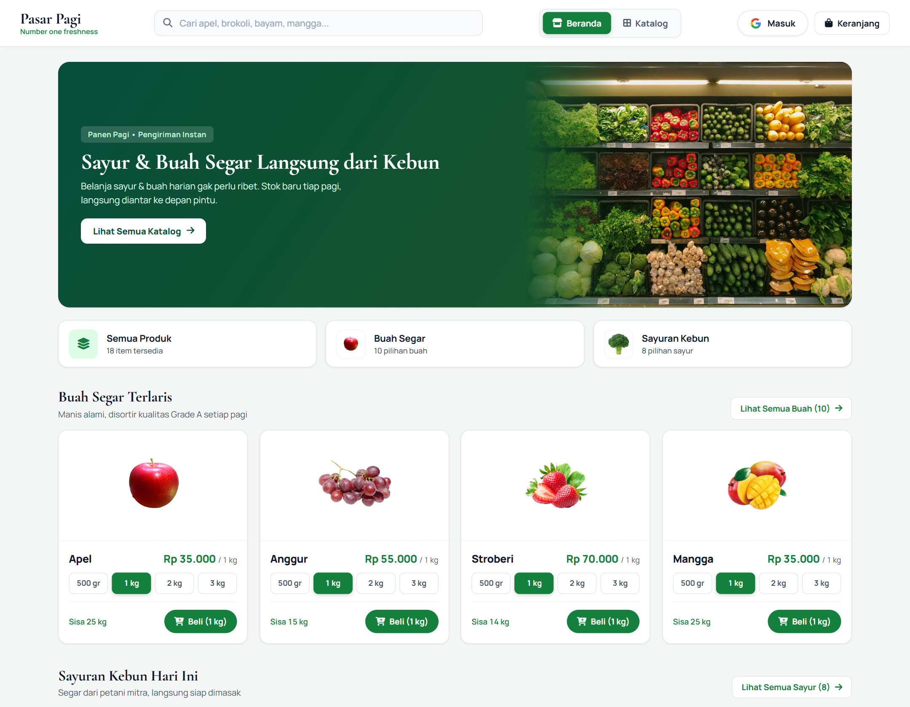
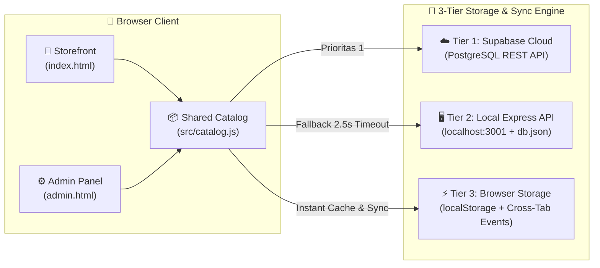

<div align="center">

# 🥬 Pasar Pagi — *Number One Freshness*

**Platform E-Commerce Buah & Sayur Segar Harian dengan Real-Time Admin Inventory & Hybrid Cloud Sync**

[](https://vitejs.dev/)
[](https://developer.mozilla.org/en-US/docs/Web/JavaScript)
[](https://supabase.com/)
[](https://expressjs.com/)
[](https://vercel.com/)

[🛒 **Buka Storefront**](#🚀-quick-start) · [⚙️ **Admin Dashboard (`/admin.html`)**](#🛠️-admin-dashboard--manajemen-stok) · [🏗️ **Arsitektur Sistem**](#🏗️-arsitektur-hybrid-sync)

<br />



</div>

---

## ✨ Tentang Pasar Pagi

**Pasar Pagi** adalah aplikasi web belanja bahan pangan segar (*fresh produce*) berdesain hangat dan organik yang menghubungkan hasil panen kebun pagi langsung ke meja makan pelanggan. Dirancang dengan pendekatan **Zero-Framework Bloat** (100% modular Vanilla ES6+ & CSS Custom Properties), aplikasi ini memuat katalog secara instan di perangkat mobile maupun desktop tanpa overhead library UI yang berat.

Dilengkapi dengan **Admin Dashboard terintegrasi (`/admin.html`)** dan arsitektur **3-Tier Hybrid Storage**, pemilik toko dapat mengatur harga, menambah/mengurangi stok, memantau pesanan masuk, dan menambah produk baru secara *real-time* — baik menggunakan **Supabase Cloud** di production maupun **Express JSON Server / LocalStorage** saat berjalan secara lokal.

---

## 🌟 Fitur Utama

| Modul | Fitur Unggulan |
| :--- | :--- |
| 🛍️ **Storefront Pelanggan** (`/`) | • **10 Pilihan Buah & 8 Pilihan Sayur** kurasi harian dengan indikator stok *real-time* (Aman / Menipis / Habis)<br>• **Smart Search & Filter** berdasarkan kategori (*Semua*, *Buah*, *Sayur*) dan pengurutan harga/nama<br>• **Quick-View Modal** & pemilihan metode potong/kemas khusus tiap produk<br>• **Responsive Mobile Bottom Bar & Slide-Over Cart Drawer** yang dioptimalkan untuk satu tangan |
| 🧾 **Checkout & Invoice Instan** | • **Multi-Metode Pembayaran**: QRIS Instan (dengan *countdown timer*), Transfer Bank / VA, dan COD (*Bayar di Tempat*)<br>• **Cetak Struk PDF Otomatis** menggunakan `jsPDF` langsung di browser pelanggan<br>• **Integrasi WhatsApp Order** otomatis dengan rincian item, alamat, koordinat GPS, dan nomor pesanan<br>• **Pemotongan Stok Otomatis** begitu pesanan dikonfirmasi |
| 🛠️ **Admin Dashboard** (`/admin.html`) | • **PIN Protection (`admin123`)** untuk keamanan akses pengelola toko<br>• **Inline Stock Stepper (`-1`, `+1`, `+5`)** & **Inline Price Editor** langsung dari tabel inventaris<br>• **Full CRUD Produk**: Tambah produk baru, edit foto/deskripsi/nutrisi, atau hapus produk<br>• **Manajemen Pesanan Masuk**: Pantau status pesanan (*Baru*, *Diproses*, *Selesai*, *Batal*) & buka chat WA pelanggan 1-klik<br>• **1-Click Cloud Database Setup**: Hubungkan ke Supabase langsung dari UI Admin + generator SQL Schema otomatis |

---

## 🏗️ Arsitektur Hybrid Sync

Pasar Pagi menggunakan sistem sinkronisasi berlapis (**3-Tier Fallback**) yang menjamin aplikasi **tidak pernah mati** meskipun koneksi backend sedang offline:



1. **Tier 1 — Supabase Cloud (Production)**: Jika kredensial Supabase aktif, seluruh perubahan stok/harga di Admin dan pesanan pelanggan langsung tersimpan di PostgreSQL Cloud.
2. **Tier 2 — Local Express Server (`server/index.js`)**: Saat pengembangan lokal tanpa cloud, data disimpan secara persisten ke `server/data/db.json` melalui REST API di port `3001`.
3. **Tier 3 — Instant Browser Sync (`localStorage`)**: Menjamin perubahan stok di tab `/admin.html` langsung terlihat di tab `/` dalam hitungan milidetik tanpa perlu *refresh* halaman.

---

## 📂 Struktur Folder

```text
pasar-renzie/
├── public/                 # Aset gambar statis produk (buah, sayur, banner kategori)
├── server/                 # Backend API lokal & integrasi payment gateway
│   ├── index.js            # Express REST API (/api/products, /api/orders, /api/checkout)
│   └── mpg.js              # Modul helper Maybank Payment Gateway (MPG)
├── src/                    # Kode sumber utama (Modular ES6)
│   ├── catalog.js          # Single source of truth katalog 18 produk & helper Supabase
│   ├── main.js             # Logic utama Storefront (keranjang, filter, checkout WA/PDF)
│   ├── style.css           # Stylesheet utama Storefront (Warm Organic Design System)
│   ├── admin.js            # Logic Admin Dashboard (CRUD stok, harga, pesanan, cloud setup)
│   └── admin.css           # Stylesheet khusus Admin Dashboard
├── index.html              # Entry point Storefront Pelanggan (/)
├── admin.html              # Entry point Admin Dashboard (/admin.html)
├── vite.config.js          # Konfigurasi multi-page bundle Vite
└── vercel.json             # Konfigurasi deployment & security headers (CSP, HSTS, XFO)
```

---

## 🚀 Quick Start

### 1. Clone & Install Dependencies

```bash
git clone https://github.com/Renzitaroo/pasar-renzie.git
cd pasar-renzie
npm install
```

### 2. Jalankan Mode Development

```bash
# Menjalankan Vite Dev Server (Storefront + Admin UI)
npm run dev
```

- **Storefront Pelanggan**: `http://localhost:5174/`
- **Admin Dashboard**: `http://localhost:5174/admin.html` *(PIN Default: `admin123`)*

### 3. (Opsional) Jalankan Local Backend API Server

Jika ingin menyimpan perubahan stok & pesanan ke file JSON lokal (`server/data/db.json`) serta menguji endpoint payment gateway:

```bash
npm run server
```
> Server berjalan di `http://localhost:3001` dengan endpoint `GET/PUT/POST /api/products`, `GET/POST /api/orders`, dan `GET /api/health`.

### 4. Build untuk Production

```bash
npm run build
npm run preview
```

---

## 🛠️ Admin Dashboard & Manajemen Stok

Buka **`/admin.html`** untuk masuk ke pusat kendali toko:

1. Masukkan PIN standar: **`admin123`** *(dapat diubah melalui variabel `VITE_ADMIN_PIN` di `.env`)*.
2. **Atur Stok & Harga Cepat**:
   - Gunakan tombol **`-1`**, **`+1`**, **`+5`**, atau ketik langsung angka stok di kolom **Stok**.
   - Ketik harga baru di kolom **Harga (Rp)** — perubahan otomatis tersimpan saat kursor keluar (*blur*) atau menekan `Enter`.
3. **Hubungkan ke Supabase (Cloud)**:
   - Klik tombol **☁️ Setup Database** di pojok kanan atas Admin Dashboard.
   - Salin **SQL Schema** yang disediakan ke **Supabase SQL Editor** Anda, lalu masukkan `Project URL` dan `Anon Key`.

---

## 🔐 Konfigurasi Environment (`.env`)

Salin `.env.example` menjadi `.env` jika ingin mengonfigurasi variabel secara statis:

```env
# Konfigurasi Cloud Database (Opsional - bisa juga diatur lewat UI /admin.html)
VITE_SUPABASE_URL=https://your-project-id.supabase.co
VITE_SUPABASE_ANON_KEY=your-supabase-anon-key
VITE_ADMIN_PIN=admin123

# Konfigurasi Local Express Backend (Opsional)
PORT=3001
FRONTEND_ORIGIN=http://localhost:5174
```

---

<div align="center">

Dibuat dengan 🌱 untuk kesegaran harian terbaik — **Pasar Pagi (Number One Freshness)**

</div>
